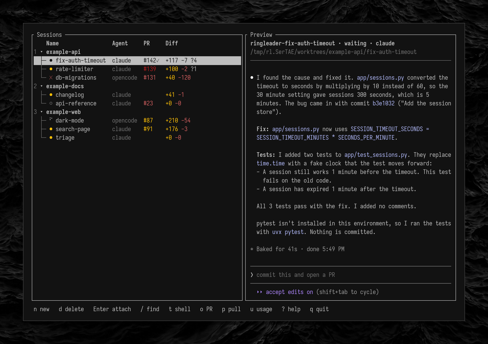

# Ringleader

[](https://github.com/KarlHarnois/ringleader/actions/workflows/ci.yml)
[](https://github.com/KarlHarnois/ringleader/tags)
[](LICENSE)
[](#install)
[](#install)

Ringleader is a tmux session manager for Claude Code and opencode. Each session runs an agent in its own git worktree and branch, or in the repo's main checkout. Ringleader's TUI lists the sessions grouped by repo and shows how each one is doing.



Ringleader runs on Linux and Apple Silicon macOS.

## Install

**Install Ringleader with [Homebrew](https://brew.sh) on Apple Silicon macOS:**

```sh
brew install KarlHarnois/tap/ringleader
```

**Install Ringleader with [Nix](https://nixos.org/download/):**

```sh
nix profile add github:KarlHarnois/ringleader
```

**If your Nix is older than 2.30, run `nix profile install` instead of `nix profile add`.**

Both installs bring Ringleader's own tmux and git, and leave yours untouched.

## First run

**Run `ringleader` in a directory that holds your repos.** The command opens the TUI. If no config exists, the command writes a commented config with Claude Code and opencode as agents.

Sessions run on Ringleader's own tmux server. The server ignores your tmux config, and its sessions do not show in your `tmux ls`. Ctrl-Q detaches you from a session and returns you to the TUI or the shell you attached from. Ctrl-Space opens a menu of session actions.

## Theme

**To change the TUI's colors, write a `theme.toml` file next to the config.** Ringleader reads the file at startup and when you press `r`. A role that the file leaves out keeps its default style, whose colors come from your terminal's palette.

```toml
selected = { bg = "#333333", bold = true }
dim = { fg = "240" }

[state]
exited = { fg = "red" }
```

A dotted role goes under its table: `state.exited` is `exited` under `[state]`. If a left-out role has a Follows entry, the role starts from the style of the role it follows.

| Role | Follows | What it colors |
|---|---|---|
| `base` |  | all text and the background |
| `selected` |  | the cursor row and the focused field |
| `selected_out_of_focus` |  | the cursor row while the terminal lacks focus |
| `selected_text` |  | selected text |
| `accent` |  | hot keys |
| `dim` |  | secondary text |
| `emphasis` |  | names and headings |
| `matched` | `emphasis` | the letters a search matched |
| `error` |  | errors |
| `warning` |  | warnings |
| `insertions` |  | added-line counts |
| `deletions` |  | removed-line counts |
| `approved` | `insertions` | an approved pull request |
| `border` |  | the borders of the session list and the preview |
| `title` |  | panel and dialog titles |
| `dialog.border` | `border` | the borders of dialogs and the session menu |
| `separator` | `dim` | rule lines |
| `table.header` | `emphasis` | the session list's column header |
| `repo.number` | `dim` | the number before a repo name |
| `repo.arrow` |  | the fold arrow before a repo name |
| `repo.name` | `emphasis` | repo names |
| `session.branch_prefix` | `dim` | the branch prefix before a session name |
| `session.agent` | `dim` | the agent column |
| `session.untracked` |  | the untracked-files marker |
| `hint` | `dim` | hint lines in dialogs |
| `hint_bar.key` |  | keys in the hint bar |
| `hint_bar.text` |  | actions in the hint bar |
| `notice` | `dim` | notices such as a search in progress |
| `count` | `dim` | match counts in the finders |
| `status.info` |  | information in the status bar |
| `status.error` | `error` | errors in the status bar |
| `status.note` | `warning` | the selected session's note in the status bar |
| `prompt.cursor` | `selected` | the cursor in a prompt |
| `prompt.selection` | `selected_text` | selected text in a prompt |
| `prompt.rule` |  | the rule around a focused prompt |
| `setting.key` | `dim` | the key labels on the new-session status line |
| `setting.main_checkout` | `warning` | the main-checkout setting |
| `menu.key` | `accent` | hot keys in the session menu |
| `menu.disabled` | `dim` | disabled items in the session menu |
| `usage.agent` | `emphasis` | agent names in the usage view |
| `usage.bar` |  | usage bars |
| `usage.reset` | `dim` | reset times in the usage view |
| `help.heading` | `emphasis` | headings in the help view |
| `preview.title` | `emphasis` | the session title in the preview |
| `preview.path` | `dim` | the worktree path in the preview |
| `state.working` |  | a working session |
| `state.waiting` |  | a session that waits for you |
| `state.exited` |  | a session whose agent exited |
| `state.stopped` | `dim` | a stopped session |
| `state.unmanaged` | `warning` | a tmux session that Ringleader did not create |
| `pull_request.open` |  | an open pull request |
| `pull_request.draft` | `warning` | a draft pull request |
| `pull_request.merged` |  | a merged pull request |
| `pull_request.closed` |  | a closed pull request |

A role's style replaces the role's whole default. A style takes `fg` and `bg`, each a color. A style also takes these modifiers, each `true` or `false`:

- `bold`
- `dim`
- `italic`
- `underlined`
- `reversed`
- `crossed_out`

A color takes one of these forms:

- `default`, which keeps the terminal's color
- an ANSI name, such as `red` or `bright_cyan`
- a number from 0 to 255
- `#rrggbb`

If the `NO_COLOR` variable is set and not empty, Ringleader drops every color and keeps the modifiers.

## CLI

```
ringleader
ringleader list [--json]
ringleader new --name <n> --repo <r> [--agent <a>] [--base-branch <b> | --main-checkout] [--plan] [--prompt <text>]
ringleader delete <name>... [--force] [--forget]
ringleader attach <name>
ringleader send <name> <prompt>
ringleader rename <old> <new>
ringleader restart (<name>... | --all)
ringleader stop (<name>... | --repo <r>)
ringleader repo add <path> [--name <n>] [--base-branch <b>]
ringleader repo remove <name>
ringleader repo list
ringleader doctor [--json]
```

Every command accepts `--config <path>` and `--log-level <level>`.

## Exit codes

| Code | Meaning |
|---|---|
| 0 | success |
| 1 | invalid input or any other failure |
| 2 | no session or `[[repos]]` entry with the given name |
| 3 | conflict with existing state |

A command given several names exits with the code of the first name that failed.

Conflicts with existing state include these:

- a taken name or branch
- a running session
- a delete that would lose work
- a held lock
- a `send` to a stopped session, or to an agent away from its prompt

## Skills

Unless an agent's config turns them off, each Claude Code and opencode session gets these skills:

| Skill | What it does |
|---|---|
| `managing-ringleader-sessions` | starts and prompts other sessions, and manages them through the CLI |

Claude Code lists each skill as `/ringleader:<skill>`.
